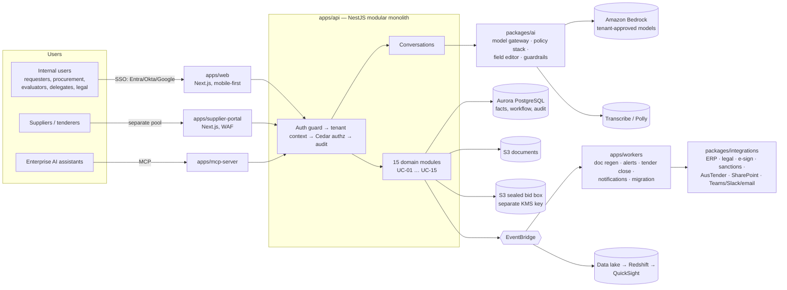

# Intuitive Fusion — Architecture

Status: skeleton v0.1 · derived from Requirements Register v0.2 (BRS v1.1 + Detailed Design) · AWS
reference architecture per BRS §5 (service selection indicative, to be confirmed in solution design).

## 1. What the platform does

An AI-first procurement and contract lifecycle platform. A business user says (or types) what they
need; the AI turns that conversation into every artefact the process needs and keeps them in sync:

```
Request ─► Procurement plan ─► RFx / tender pack ─► Tender portal (sealed bids)
   │              │                    │                       │
   └──── conversational AI (voice/text) fills & amends every field ──────┐
                                                                         ▼
Contract management ◄─ Contract signing ◄─ Contract drafting ◄─ Evaluation report ◄─ Evaluation
 (alerts, variations,   (delegate + legal    (clause assembly,     (recommendation,     (COI, scoring,
  extensions, spend)     authority, e-sign)   deviations)           delegate approval)    consensus, BAFO)
```

Two engagement models (FR-0040): **self-service** for low-value/low-risk buys (AI-guided end to end)
and **procurement-team-led** for high-value/high-risk ones. Governance runs throughout: delegation
of authority, conflict of interest, segregation of duties, probity, and a complete audit trail.

## 2. System view



## 3. Key design decisions

### 3.1 Facts, not copies
The client's narrative is explicit that the same information appears in the plan, tender pack,
evaluation report and contract, and that a change in one place must flow everywhere ("add milestone 7
in the plan → updated in the tender pack"). So procurement data is stored **once** as
`ProcurementField` facts (`packages/domain/src/facts.ts`), and every document is a template whose
placeholders *bind* to facts (`packages/documents` `bindTemplate`). A `fact.changed` event re-renders
affected documents — live for early-stage artefacts, batched for later ones (NFR-P01, NFR-P02).

### 3.2 AI drafts, humans decide
- One `ModelGateway` for all model calls: per-tenant approved models, region-locked, never public
  endpoints (NFR-C01, NFR-M06, SEC-D05, SEC-D09, SEC-TP07).
- Four-layer **policy stack**: platform framework → policy group (e.g. CPR) → enterprise policy →
  enterprise knowledge (retrieved, tenant-scoped).
- **Scoped edits** ("change paragraph 3 only") are spliced by deterministic code so untouched content
  is guaranteed unchanged (FR-0745).
- **Recipes** pin steps, prompt version and temperature 0 for repeatable output (client: "same
  output each time"), seeded from a best-practice library refreshed weekly (FR-0765, NFR-R03).
- Supplier content is untrusted input — wrapped and screened for prompt injection (SEC-AP08).
- Every AI action is audited with the model id; stage gates require human approval (NFR-AV05,
  SEC-AC12 makes human-vs-AI gates configurable).

### 3.3 Security and probity by construction
| Concern | Mechanism | Requirements |
|---|---|---|
| Tenant isolation | `tenantId` on every row + Postgres RLS + Cedar `tenant-isolation` forbid | SEC-D10 |
| Sealed bids | Separate S3 bucket + KMS key; app role is write-only; Cedar forbid until close | SEC-AC13, SEC-D03/D04 |
| Segregation of duties | Cedar forbid: tender admin / probity ≠ evaluator | FR-0190, SEC-AC06 |
| COI before bids | Cedar forbid until declaration recorded | FR-0300 |
| Pricing isolation | Evaluator streams; technical can't read commercial | FR-0260, SEC-AC07 |
| Delegation of authority | Value-threshold permits; separate signing authority | SEC-AC04/AC05 |
| Audit | Append-only table (INSERT-only role), hash chain, S3 Object Lock archive | SEC-L01..L05 |
| Identity | Internal SSO pool (MFA) vs separate supplier pool | SEC-A01..A03, TR-05 |

### 3.4 Modular monolith first
One deployable API with strict module boundaries (one module per use case) rather than ~15
microservices on day one. Heavy or spiky work (document rendering, AI batch, migration, tender-close
surges) runs in separately scaled workers. Modules can be extracted later along these seams. See
`docs/adr/0001-modular-monolith.md`.

### 3.5 Deployment topology
Per stage and per nominated region (default Sydney, `ap-southeast-2`). Customers that elect their
own AWS account or a specific country get their own deployment — the data-sovereignty objective
(OBJ-08) is met structurally rather than by policy alone.

## 4. Module map

| UC | Module (`apps/api/src/modules/…`) | In scope (Must/Should/Could) | Deferred |
|---|---|---|---|
| UC-01 | `intake` | 13 / 7 / 0 | 3 |
| UC-02 | `procurement-plan` | 3 / 2 / 0 | 1 |
| UC-03 | `rfx` | 6 / 2 / 0 | 1 |
| UC-04 | `tender-portal` | 10 / 2 / 2 | 1 |
| UC-05 | `suppliers` | 4 / 1 / 0 | 3 |
| UC-06 | `evaluation` | 11 / 2 / 0 | 0 |
| UC-07 | `evaluation-report` | 5 / 1 / 0 | 0 |
| UC-08 | `contracts` | 12 / 6 / 0 | 1 |
| UC-09 | `contract-management` | 15 / 5 / 0 | 1 |
| UC-10 | `reporting` | 13 / 1 / 0 | 5 |
| UC-11 | `migration` | 5 / 0 / 0 | 0 |
| UC-12 | `admin` | 6 / 1 / 0 | 0 |
| UC-13 | `governance` | 15 / 4 / 0 | 0 |
| UC-14 | `integrations` | 1 / 0 / 1 | 4 |
| UC-15 | `collaboration` | 3 / 1 / 0 | 0 |

Each module folder has a generated `REQUIREMENTS.md` with full descriptions and acceptance
criteria. Non-functional and security requirements are cross-cutting and implemented in
`apps/api/src/platform`, `packages/*` and `infra/cdk`; their IDs are cited in code comments.

## 5. Suggested build sequence

1. **Foundations** — tenancy, SSO + supplier pool, Cedar authz, audit trail, CI/CD, IaC, observability.
2. **Intake → plan** — conversation layer, fact store, complexity scoring, plan generation, approvals
   with stamps, COI at plan stage. (Delivers the headline "describe it and it's drafted" experience.)
3. **Tender** — RFx authoring, tender pack assembly, supplier registration, portal, sealed bid box,
   Q&A, close.
4. **Evaluation → report** — compliance gate, isolated scoring, consensus, report, delegate approval.
5. **Contract** — clause assembly, deviations, legal review, signing.
6. **Contract management** — obligations, alerts, variations/extensions, spend.
7. **Reporting, migration, integrations** — analytics layer, legacy import, ERP/legal/e-sign connectors.

Resolve the items in `docs/open-decisions.md` that touch each slice before starting it.
